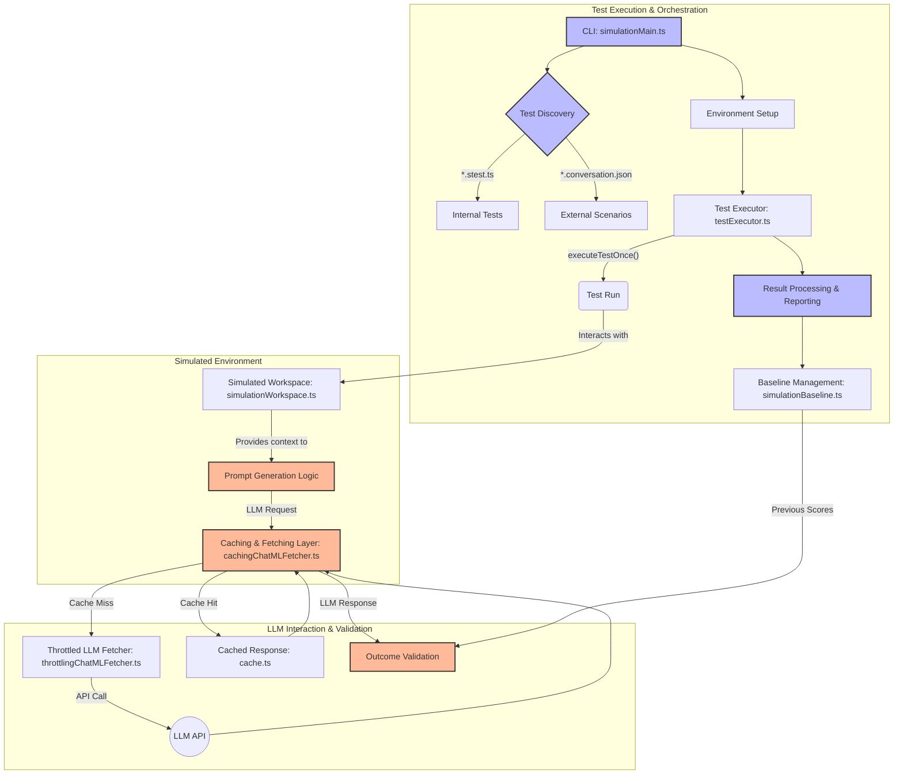

# Architectural Documentation: LLM-Centric Test Suite

This document provides a detailed architectural overview of the simulation test suite, with a special focus on its powerful capabilities for testing and validating Large Language Model (LLM) prompts and responses.

## 1. Introduction

The simulation test suite is an advanced, integration-level testing framework designed to validate the behavior of features that interact with Large Language Models (LLMs). Its primary purpose is to ensure that changes to prompts, context-gathering logic, or the models themselves produce consistent, high-quality, and correct results.

It achieves this through a combination of:
- **Simulated VS Code Environment**: Reproducible workspaces, file systems, and editor states.
- **Robust Caching Layer**: For deterministic, fast, and cost-effective test runs by caching LLM responses.
- **Scenario-Based Testing**: Defining test cases in simple, readable formats (JSON, YAML) that mimic user interactions.
- **Baseline-Driven Validation**: Comparing test outcomes against a "golden" baseline to detect regressions and improvements in LLM-generated code and responses.
- **Extensible Validation**: Using code compilers, linters, and custom assertion logic to validate the quality of LLM output.

## 2. Core Architecture

The test suite is composed of several key modules that work together to provide a comprehensive testing environment.

### Key Components

| Component | Main File(s) | Responsibility |
| --- | --- | --- |
| **Test Runner** | `simulationMain.ts` | The main entry point. Parses CLI arguments, discovers tests, sets up the environment, orchestrates test execution, and reports final results. |
| **Test Definitions**| `stest.ts`, `*.stest.ts` | Provides `ssuite` and `stest` functions to define test suites and individual test cases within the codebase. |
| **Test Executor** | `testExecutor.ts` | Manages the execution of a single test scenario, including running it multiple times (`nRuns`) and aggregating the results. It sets up the necessary services for each test run. |
| **Simulation Simulators** | `inlineChatSimulator.ts`, `panelCodeMapperSimulator.ts`| These modules simulate user interactions (like inline chat or panel chat) to trigger the LLM-powered features under test. They are crucial for testing how prompts are constructed from user input and workspace context. |
| **External Scenarios** | `externalScenarios.ts`, `nesExternalTests.ts`| Discovers and loads test scenarios defined in external files (e.g., `.conversation.json`, `.yml`). This allows for easy creation of prompt-based tests without writing new code. |
| **Caching Layer** | `cachingChatMLFetcher.ts`, `cache.ts`, `completionsCache.ts`, `cacheSalt.ts` | A critical component that intercepts LLM requests. It serves responses from a local cache if available, or fetches them from the live model and caches the result for future runs. |
| **Baselines & Scoring** | `simulationBaseline.ts`, `testExecutor.ts` | Manages the `baseline.json` file, which stores the "golden standard" scores for each test. After a run, it compares current scores against the baseline to detect regressions or improvements. |
| **Distributed Execution** | `testExecutionInExtension.ts` | An advanced feature that allows tests to run within a separate, real VS Code extension host process, enabling more realistic integration testing. Communication is handled via RPC. |

## 3. The Lifecycle of a Test Run

A typical run of the test suite follows these steps:

1.  **Initiation**: A developer runs the test suite via the command line (`npm run simulate ...`).
2.  **Argument Parsing**: `simulationMain.ts` uses `minimist` to parse command-line arguments via `SimulationOptions`. These options control every aspect of the run, including which tests to run (`--grep`), how many times (`-n`), which LLM model to use (`--model`), and caching behavior (`--require-cache`).
3.  **Test Discovery**:
    -   **Internal Tests**: It imports `simulationTests.ts`, which in turn imports all `*.stest.ts` files. These files use `ssuite` and `stest` to register tests with the `SimulationTestsRegistry`.
    -   **External Scenarios**: If `--external-scenarios` is provided, `discoverTests` in `externalScenarios.ts` (or related functions for NES tests) is called to find scenario files (e.g., `.conversation.json`) and convert them into runnable `SimulationTest` objects.
4.  **Environment Setup**: `prepareTestEnvironment` in `simulationMain.ts` is called. It creates an output directory for logs and artifacts, reads the `baseline.json`, and sets up the main `SimulationTestContext`.
5.  **Execution**: `executeTests` in `testExecutor.ts` iterates through the filtered list of tests to run.
    -   It uses a `TaskRunner` to manage parallelism.
    -   For each test, `executeTestNTimes` is called, which runs the test function `n` times.
    -   Crucially, `executeTestOnce` creates a fresh dependency injection container (`TestingServiceCollection`) for each individual run, ensuring test isolation. This is where the caching layer and simulated services are instantiated.
6.  **Result Aggregation**: After all runs for a test are complete, `testExecutor.ts` calculates a final score (typically the pass rate).
7.  **Reporting and Baseline Comparison**: `simulationMain.ts` receives the results, prints a summary to the console, and compares the new scores against the `baseline.json` file, highlighting improvements and regressions.
8.  **Artifact Generation**: The run produces several artifacts in the `.simulation/out-<timestamp>/` directory, including a `report.json` with detailed results, a `scorecard.csv`, and individual test run outputs. If `--update-baseline` is passed, the main `baseline.json` is overwritten with the new results.

## 4. How LLM Prompts are Tested

This test suite is uniquely designed to provide stable, deterministic, and insightful testing for features powered by LLMs. This is achieved through a multi-faceted approach focusing on prompt generation, response caching, and robust validation.

### The Golden Standard: Cached Responses

The biggest challenge in testing LLMs is their non-deterministic nature. The test suite solves this with a powerful caching layer.

**How it works:**
- **Interceptor:** The `CachingChatMLFetcher` (and its counterparts for other services like `CachingCompletionsFetchService`) acts as a Man-in-the-Middle. Instead of hitting the live LLM endpoint, features under test interact with this caching fetcher.
- **Cache Key Generation:** When a request is made, a `CacheableChatRequest` object is created. This object contains the full request payload (messages, model, temperature, etc.). A unique SHA256 hash is computed from this object's JSON representation, combined with a **cache salt** (`cacheSalt.ts`).
  - **The Salt:** The `CHAT_ML_CACHE_SALT` is a timestamped string. Changing this salt effectively invalidates all existing cache entries, forcing the suite to regenerate responses from the live model. This is done when prompt fundamentals change.
- **Cache Storage:** The cache is a `Keyv` store backed by SQLite (`cache.ts`, `chatMLCache.ts`). The hash serves as the key, and the compressed LLM response (including metadata like request duration) is the value.
- **Cache Modes:** The `--require-cache` CLI flag is vital for CI. It forces all LLM requests to be served from the cache. If a request results in a cache miss, the entire test run fails. This guarantees that a pull request does not introduce any unintended changes to prompts that would result in new, un-vetted LLM calls.

### Anatomy of a Prompt Test

A typical prompt test, whether defined in a `.stest.ts` file or an external scenario, follows this structure:

1.  **Arrange (Setup the Context)**:
    -   A `SimulationWorkspace` is created with a specific set of files (`fromFixture(...)`).
    -   The active editor, cursor position, and selection are set to mimic a user's state.
    -   Relevant services are mocked or configured (e.g., providing specific diagnostics via `SimulationTestProvider`).

2.  **Act (Simulate User Interaction)**:
    -   A simulator function like `simulateInlineChat` or `simulatePanelCodeMapper` is called with the user's query (e.g., `/fix "some error"`).
    -   This simulator invokes the application's actual intent detection (`IntentDetector`) and prompt generation logic (e.g., `EditCodeIntent`, `GenerateCodeIntent`).
    -   The prompt generation logic gathers context from the simulated workspace (active file, selection, diagnostics, etc.) to build the final prompt messages sent to the LLM.

3.  **Assert (Validate the Outcome)**:
    -   The LLM response (served from the cache) is applied to the workspace (e.g., as a code edit).
    -   The `validate` function of the test case is executed. This function has access to the final state of the workspace and the LLM response.
    -   **Outcome Validators (`outcomeValidators.ts`)**: A suite of assertion helpers are used:
        - `assertNoDiagnosticsAsync`: Runs a compiler or linter (like `tsc` or `eslint` via `diagnosticProviders`) on the modified file to ensure the LLM-generated code is syntactically correct.
        - `assertLessDiagnosticsAsync`: For `/fix` intents, asserts that the number of errors has decreased.
        - `assertInlineEditShape`: Checks that the code edit is minimal and targets the expected lines.
        - `assertContainsAllSnippets`, `assertLooksLikeJSDoc`: Perform string-based validation on the output.
    -   **Rubrics (`rubric.ts`)**: For more complex scenarios, a `rubric` can be used to assign a partial score based on which subset of assertions passed.

### Scenario-Based Testing (`/tests` command, etc.)

A significant portion of the test suite is driven by external scenarios, particularly for testing `/tests`.

-   **Discovery**: The test runner discovers tests in language-specific subdirectories (e.g., `slash-test/testGen.ts.stest.ts`).
-   **Structure**: Each test file uses `forInlineAndInline2` to run tests against different internal implementations of the chat feature.
-   **Simulation**: `simulateInlineChatWithStrategy` is called, which sets up the workspace from a fixture file.
-   **Query**: The query is typically `/tests`.
-   **Validation**:
    -   `assertWorkspaceEdit(outcome)`: Asserts that the response was a workspace edit (creating/modifying a test file).
    -   The new file's content is inspected to ensure it contains expected testing boilerplate (`'import'`, `'describe'`, `'it'`).
    -   For TypeScript/JavaScript, `assertNoSyntacticDiagnosticsAsync` is often run to confirm the generated test code is valid.

This approach allows for rapid, data-driven development of prompt-based features. A developer can add a new fixture file representing a code snippet and a corresponding query, then iterate on the prompt until the test passes, ensuring both the generated test file and its content are correct.

## 5. Advanced Features

### Distributed Testing (Extension Host Execution)

For tests that need a more realistic environment, the suite can spawn a separate VS Code server process and install the extension into it.

-   **Orchestration**: `TestExecutionInExtension` in `testExecutionInExtension.ts` manages this process. It packs the extension into a VSIX, launches the server, and installs it.
-   **Communication**: It uses `SimpleRPC` over a socket connection to communicate between the main test runner process and the extension host process.
-   **Proxied Services**: Services like `ProxiedSimulationOutcome` and `ProxiedSimulationEndpointHealth` forward calls from the extension host back to the main process via RPC, allowing for centralized result collection. This enables tests to run in a fully isolated, realistic environment while still integrating with the main test reporting and baseline system.

### Diagnostic Providers

The `simulation/diagnosticProviders/` directory contains logic to run actual compilers and linters like `tsc`, `pylint`, `ruff`, and `roslyn` on files in the simulated workspace. This is the cornerstone of validation for `/fix` and code generation intents, as it provides a definitive answer to whether the LLM-generated code is correct. These providers are also cached to avoid re-running slow compilation steps.

## 6. Key Files & Their Roles

| File/Directory | Role |
| :--- | :--- |
| `simulationMain.ts` | **Main entry point**. Handles CLI args, test discovery, and high-level orchestration. |
| `testExecutor.ts` | Manages the execution loop for a single test, creates services, and collects results. |
| `base/stest.ts` | Defines the `ssuite` and `stest` functions for creating tests and suites. The core of test definition. |
| `simulationTests.ts`| Aggregates all internal `*.stest.ts` files to be discovered by the test runner. |
| `simulation/externalScenarios.ts` | Discovers and loads tests from external `.conversation.json` files. |
| `simulation/inlineChatSimulator.ts` | Simulates user interaction with the inline chat feature, triggering prompt generation and LLM calls. |
| `base/cachingChatMLFetcher.ts`| The heart of the LLM testing strategy. Intercepts LLM requests and uses a cache. |
| `base/cache.ts`, `base/completionsCache.ts` | Implements the SQLite-based caching backend. |
| `base/simulationBaseline.ts`| Manages reading, comparing, and writing the `baseline.json` file for regression testing. |
| `simulation/outcomeValidators.ts`| Contains assertion helpers for validating test outcomes. |
| `simulation/diagnosticProviders/*` | Wrappers around command-line tools (tsc, eslint, etc.) to get code diagnostics. |
| `base/testExecutionInExtension.ts` | Orchestrates running tests in a separate, real extension host process. |
